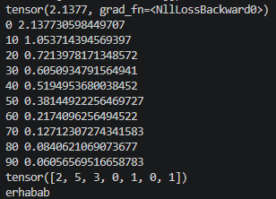
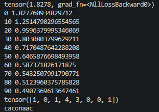
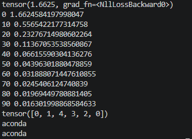
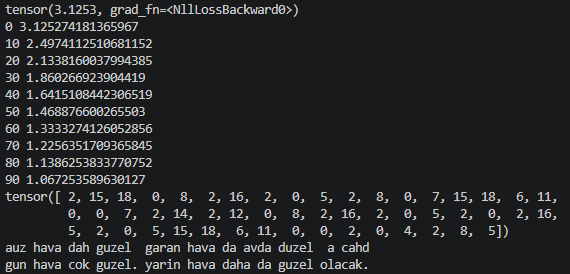
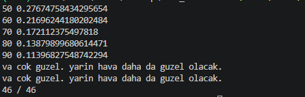
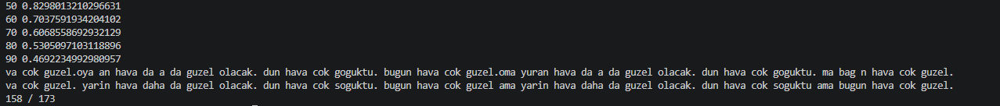

# Mini Model Projesi

Amaç: Sıfırdan küçük bir dil modeli yapıp nasıl çalıştığını öğrenmek.

## Sözlük
- **Model:** İçinde sayılar bulunan bir dosya. Bilgi, sayıların birlikte oluşturduğu dizilişte saklanır.
- **LLM:** Sıradaki kelimeyi/harfi tahmin etmek için eğitilmiş büyük model.
- **Parametre:** Modelin içindeki tablodaki her bir sayı. Başta rastgeledir, eğitimle azar azar değişir.
- **Tokenizer:** Harfleri/kelimeleri sabit numaralara çeviren sözlük. Eğitimle değişmez.
- **Embedding (kart tablosu):** Her numaraya bir sayı kartı veren tablo.
- **Loss (kayıp):** Tahminin ne kadar yanlış olduğunu gösteren tek bir sayı.
- **Gradient (grad):** Her parametre için "bunu artırırsam loss nasıl değişir?" sorusunun cevabı. Eksiyse artırılır, artıysa azaltılır.
- **Optimizer:** Gradient'lere bakarak parametreleri azar azar güncelleyen araç (burada SGD).
- **Learning rate (lr):** Her güncellemede parametrelerin ne kadar değişeceği.
- **Eğitim:** Tahmin et, loss'u ölç, gradient'i hesapla, parametreleri güncelle, tekrarla.
- **Makine öğrenmesi:** Kuralı elle yazmak yerine örneklerden öğrenen sistemler.
- **Bağlam (context):** Modelin tahmin yaparken baktığı önceki harf sayısı. Büyüdükçe model aynı görünen durumları ayırabilir.

## Yaptıklarım
1. Python, klasör, venv ve PyTorch kurulumu
2. Tokenizer: "merhaba" harflerini numaralara çevirdim
3. Parametre tablosu oluşturdum (6 harf x 2 sayı = 12 parametre)
4. Numaralardan kartları çektim, kartlardan her harf için puan ürettim (+18 parametre, toplam 30)
5. Loss hesapladım (başlangıçta yaklaşık 1,8)
6. Her parametre için "bunu biraz artırırsam loss düşer mi?" sorusunun cevabını (gradient) hesaplayıp parametreleri bu yöne azıcık çevirdim, loss düştü
7. Bunu 100 tur döngüye koydum: loss 1,84'ten 0,05'e indi
8. Modele sordum, her harften sonra gelen harfi doğru buldu (`erhabab`)
9. "anaconda" ile denedim, model zorlandı (aşağıda)
10. Modeli önceki harfi de görecek hâle getirdim (iki harfli model), sorun çözüldü
11. Bağlamı 8 harfe çıkarıp uzun cümleyi çözdüm (Eğitim 3)

## Deney: "anaconda"
"merhaba" yerine "anaconda" ile denedim. Model 7 tahminden 5'ini doğru buldu, loss 0,47'ye kadar indi ama sıfıra inmedi.

Sebep: Model sadece o anki harfe bakıyor, öncesini hatırlamıyor. "anaconda"da `a`'dan sonra bazen `n` bazen `c` geliyor, ama model iki `a`'yı da aynı karttan gördüğü için ikisine de aynı cevabı veriyor. Aynı durum `n` harfinde de var.

Sonuç: Doğru tahmin için modelin önceki harfleri de görmesi gerekiyor. Gerçek modellerde bunu attention yapıyor.

## Eğitim 1: Tek harfli model

> Model, tahmin yaparken sadece **o anki harfe** bakıyor. Önceki harfleri görmüyor.

### Özet

| | ✅ Sonuç | ❌ Yapamadığı |
|---|---|---|
| **Kelime** | merhaba | anaconda |
| **Loss** | 2,14 → **0,06** | 1,83 → **0,49** |
| **Modelin çıktısı** | erhabab | caconaac |
| **Doğru cevap** | erhaba | naconda |
| **Doğru tahmin** | **6 / 6** | **5 / 7** |
| **Neden?** | Her harften sonra hep aynı harf geliyor, ezberledi | `a` ve `n` harflerinden sonra iki farklı harf geliyor, ayıramadı |

### Çıktılar

<table>
  <tr>
    <th align="center">✅ merhaba</th>
    <th align="center">❌ anaconda</th>
  </tr>
  <tr>
    <td></td>
    <td></td>
  </tr>
</table>

## Eğitim 2: İki harfli model

> Model, tahmin yaparken **son iki harfe** bakıyor (önceki harf + şimdiki harf). Tur sayısı: 100.

### Özet

| | ✅ Sonuç | ❌ Yapamadığı |
|---|---|---|
| **Metin** | anaconda | bugun hava cok guzel. yarin hava daha da guzel olacak. |
| **Parametre sayısı** | 35 | 133 |
| **Loss** | 1,66 → **0,016** | 3,13 → **1,07** |
| **Modelin çıktısı** | aconda | auz hava dah guzel  garan hava da avda duzel  a cahd |
| **Doğru cevap** | aconda | gun hava cok guzel. yarin hava daha da guzel olacak. |
| **Doğru tahmin** | **6 / 6** | **36 / 52** |
| **Neden?** | Önceki harf de görününce `a`'dan sonra `n` mi `c` mi geleceği ayrıldı | 100 turda loss hâlâ düşüyordu, model öğrenmeyi bitirmemişti. Ayrıca aynı iki harften sonra farklı harfler geliyor, model ikisini ayıramıyor |

### Çıktılar

<table>
  <tr>
    <th align="center">✅ anaconda</th>
    <th align="center">❌ cümle</th>
  </tr>
  <tr>
    <td></td>
    <td></td>
  </tr>
</table>

### Çıkarım

Tek kelimede iki harf yetti, ama cümlede yetmedi. Tur sayısını 1000'e çıkarınca loss 0,30'a indi ve 44 / 52 doğru bulundu, ama sıfıra inmedi. Yani sorun sadece tur eksikliği değil, modelin son iki harften fazlasını görememesi. Çözüm daha uzun ve daha akıllı bağlam, yani attention.

## Eğitim 3: Sekiz harfli model

> Model, tahmin yaparken **son 8 harfe** bakıyor. Eğitim 2'den tek fark bu: 2 yerine 8 kart yan yana. Toplam 361 parametre, 1000 tur.

### Özet

| | ✅ Cümle | ❌ Paragraf |
|---|---|---|
| **Metin** | bugun hava cok guzel. yarin hava daha da guzel olacak. | 5 cümlelik paragraf (181 harf) |
| **Parametre** | 361 | 418 |
| **Loss** | 3,44 → **0,003** | → **0,049** |
| **Doğru tahmin** | **46 / 46** | **169 / 173** |
| **Neden?** | 8 harf yetiyor, her pencerenin cevabı tek | Aynı görünen 3 pencerenin cevapları farklı, model çoğunluğu seçiyor |

<table>
  <tr>
    <th align="center">✅ cümle</th>
    <th align="center">❌ paragraf</th>
  </tr>
  <tr>
    <td></td>
    <td></td>
  </tr>
</table>

### Çıkarım

Paragrafta 4 hata var: `soguktu` iki kere `goguktu` oldu, `guzel ama` ve `soguktu ama` iki kere `guzel.ama` ve `soguktu.ama` oldu. Sebep: `ava cok `, `ok guzel` ve ` soguktu` pencerelerinin hepsinden sonra farklı harfler geliyor ve model sadece son 8 harfi görüyor. Tur sayısını artırmak çözmüyor, çünkü sorun eğitim süresi değil, bakılan harf sayısı.

Çözüm: Sabit pencere yerine, metnin başından beri her şeye bakabilen ve hangi parçaya ne kadar bakacağını seçen bir yapı. Buna **attention** deniyor.

### Üç eğitimin karşılaştırması

| | Bakılan harf | Parametre | Çözdüğü | Yapamadığı |
|---|---|---|---|---|
| Eğitim 1 | 1 | 30 / 25 | merhaba | anaconda |
| Eğitim 2 | 2 | 35 / 133 | anaconda | uzun cümle (36 / 52) |
| Eğitim 3 | 8 | 361 / 418 | uzun cümle (46 / 46) | paragraf (169 / 173) |